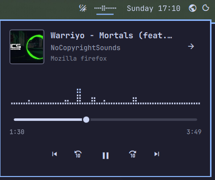
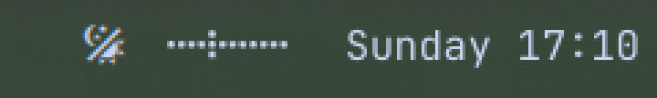

# Soundwave — live dot sound wave for the Omarchy bar

A small, btop-style dot wave in your bar that follows the **real audio**
coming out of your speakers. Click it for a now-playing card with a seek bar,
transport controls, and a button that jumps straight to the window the sound
is playing from.





## Features

- **Live wave from real audio.** Levels come from [cava](https://github.com/karlstav/cava)
  reading your PipeWire output, so the dots move with the music and go flat in
  silence. A muted browser tab, a muted app stream, or a muted output device
  all read as silence.
- **Shows up only when something is audible.** It slides in like the tray
  drawer when sound starts and slides out a few seconds after it stops.
  It stays put while its card is open. It goes by which audio streams are
  actually playing, not by what a player claims, so it keeps working when
  two browser tabs play at once.
- **Several sources at once.** The wave is the mix of everything you hear.
  When more than one thing is playing, or sound comes from somewhere other
  than the card's player, the card lists each source under **Playing now**,
  by tab or track title and app. Click a row to jump to its window.
- **Now-playing card:** album art, title, artist, and which app is playing,
  plus a three-line braille dot graph in your theme's accent colour.
- **Seek bar** you can drag, with elapsed and total time.
- **Controls:** previous track, back 10 s, play/pause, forward 10 s, next track.
- **Go to player** (`→` in the card) focuses the window, workspace, and
  monitor the audio is coming from. Chromium-based browsers also switch to the
  playing tab.
- Follows your Omarchy theme. Works on top, bottom, left, or right bars.
  Translated into English and Polish, and it follows Omarchy's language
  setting live.
- Uses Omarchy's own media service to pick the player, so it always agrees
  with your media keys and the OSD.

## Requirements

- Omarchy with the Quickshell-based Omarchy shell (plugin `schemaVersion` 1).
- **`cava`**, an external dependency, for the live wave:

  ```sh
  omarchy pkg add cava
  ```

  Without cava the plugin still works, but the wave is a generated animation
  instead of the real audio. It still stops when the audio is muted.

## Install

```sh
omarchy pkg add cava
omarchy plugin add https://github.com/MedrekIT/omarchy-soundwave.git --enable
```

By default it lands in `centerBegin`, just left of the clock.

### Put it anywhere on the bar

It works in every bar section:

```sh
omarchy bar move medrekit.soundwave --section left          # with the workspaces
omarchy bar move medrekit.soundwave --section centerBegin   # left of the clock (default)
omarchy bar move medrekit.soundwave --section centerEnd     # right of the clock
omarchy bar move medrekit.soundwave --section right         # with the status icons
```

Add `--index N` to choose its position within a section. Avoid `center`
itself: widgets there are centred as one group with the clock, so the clock
would move off centre.

## Usage

| Action | What it does |
| --- | --- |
| Left click | Open or close the now-playing card |
| Middle click | Play / pause |
| Hover | Show the title and artist |

In the card, drag the bar to seek. Use `→` to jump to the player's window.

### Keybinding

The card can be opened from the command line, so you can bind it to a key in
`~/.config/hypr/bindings.lua`:

```lua
o.bind("SUPER + ALT + M", "Soundwave card", "omarchy-shell medrekit.soundwave toggle")
o.bind("SUPER + ALT + G", "Go to playing window", "omarchy-shell medrekit.soundwave goTo")
```

## Configure

Change these with `omarchy bar set`. Changes apply instantly.

| Setting | Default | Range | Meaning |
| --- | --- | --- | --- |
| `columns` | `10` | 4–24 | Dot columns in the bar wave. On a vertical bar it uses fewer if they don't fit. |
| `height` | `50` | 30–80 | How much of the bar's thickness the wave may use, in percent. |

```sh
omarchy bar set medrekit.soundwave columns 14
omarchy bar set medrekit.soundwave height 65
```

The wave's smoothing lives in `cava.conf` in the plugin folder
(`~/.config/omarchy/plugins/medrekit.soundwave/cava.conf`). Raise
`noise_reduction` for calmer motion or lower it for snappier motion.

## What it runs

The plugin makes **no network requests**. It runs only these local
processes:

- `pactl subscribe`, always. It is one long-running process that reports
  when audio streams start, stop, or change. Only then does the plugin run
  `pactl -f json list sink-inputs` to see which streams are playing and what
  they are called.
- `cava -p <plugin>/cava.conf` while an unmuted stream is playing. It reads
  the PipeWire output and writes numbers to the plugin. It also runs while the
  widget is hidden, because it is what notices sound in a stream. One set of
  these processes runs per monitor.
- `hyprctl clients -j`, followed by a focus dispatch, only when you press
  **Go to player**.

All track metadata is shown as plain text, never as rich text.

## Known limitations

- **Firefox doesn't always report the track length or position.** When it
  doesn't, the seek bar is hidden and the 10 s buttons fall back to the site's
  own skip action. YouTube uses 5 s for that. The seek bar comes back as soon
  as Firefox reports the length again. Chromium-based browsers, Spotify, mpv,
  and most music players always report it.
- **Firefox can't switch tabs.** Go to player focuses the right Firefox window,
  but only Chromium-based browsers can also switch to the playing tab.
- **Firefox has one media player for all its tabs.** The card's title, art,
  and controls follow whichever tab Firefox reports, usually the one that
  started playing last. Other playing tabs still show under **Playing now**
  and still move the wave, but they can't be controlled from the card.

## Remove

```sh
omarchy plugin remove medrekit.soundwave
```

Optionally remove cava too: `omarchy pkg drop cava`.

## License

[MIT](LICENSE) © 2026 Daniel Mędrek
